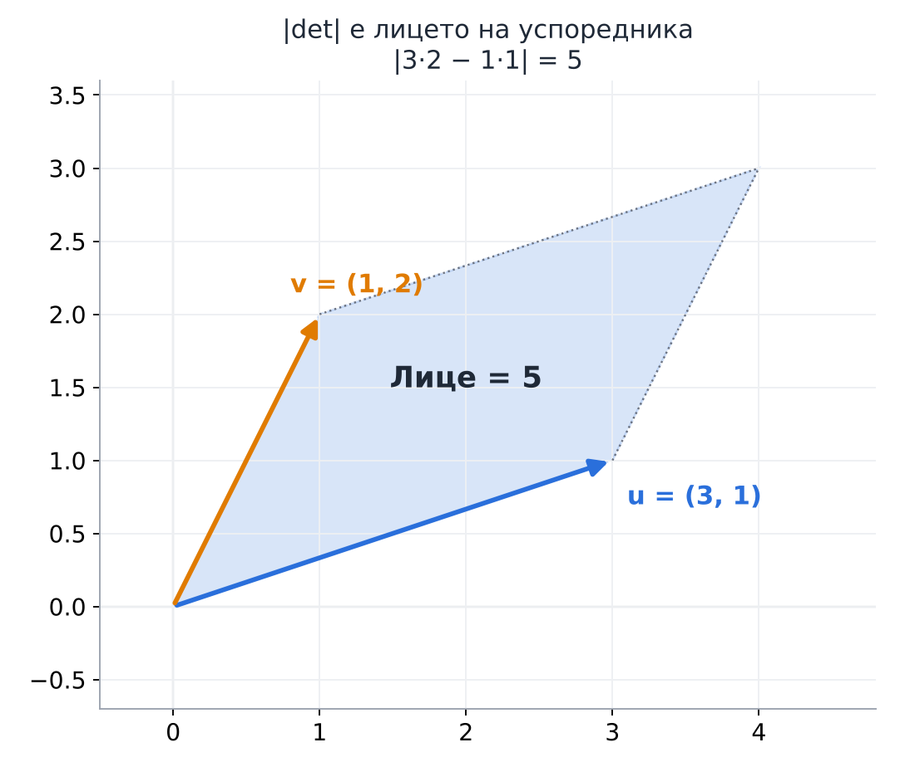
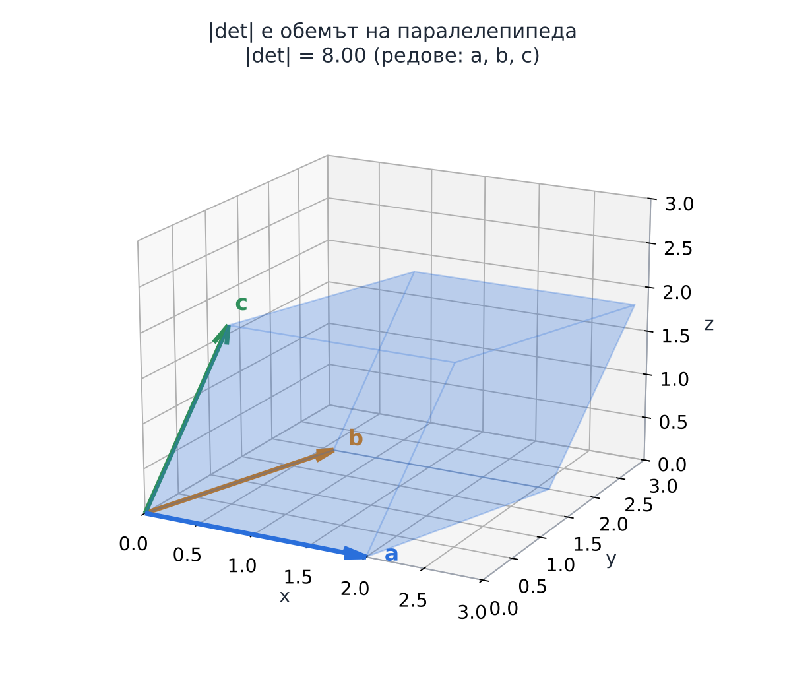

# Урок 2: Детерминанти на матрица

---

## Съдържание

- Какво е **детерминанта** на матрица и за какви матрици е дефинирана.
- Пресмятане на детерминанта за матрица $1 \times 1$, $2 \times 2$ и $3 \times 3$ (правило на Сарус, разлагане по минори).
- Геометричен смисъл на детерминантата (лице, обем, ориентация).
- Основни свойства на детерминантата.
- **Обратна матрица** $A^{-1}$: определение, пресмятане ($2 \times 2$ и чрез адюнгирана матрица), свойства, решаване на системи.
- Къде се използват детерминантите в програмирането: обратимост на матрица, системи линейни уравнения (правило на Крамер), линейна независимост, компютърна графика, машинно обучение.
- Кратки примери с код на Python (библиотека `numpy`).

---

## 1. Какво е детерминанта

**Детерминантата** е едно-единствено число, което се съпоставя на всяка **квадратна** матрица $A$ и носи информация за нея — най-вече дали матрицата е "обратима" и как тя мащабира лица/обеми. Бележи се с $\det(A)$ или $|A|$.

> Детерминантата е дефинирана **само за квадратни матрици** ($n \times n$). За правоъгълна матрица понятието няма смисъл.

Най-простият случай е матрица $1 \times 1$: детерминантата ѝ е просто самото число.

$$
A = \begin{pmatrix} 5 \end{pmatrix} \quad \Rightarrow \quad \det(A) = 5
$$

За по-големи матрици детерминантата се пресмята по конкретни формули, разгледани по-долу.

---

## 2. Детерминанта на матрица $2 \times 2$

За матрица

```math
A = \begin{pmatrix} a & b \\ c & d \end{pmatrix}
```

детерминантата се пресмята като произведението на елементите на главния диагонал минус произведението на елементите на "вторичния" диагонал:

$$
\det(A) = ad - bc
$$

**Пример:**

```math
A = \begin{pmatrix} 2 & 3 \\ 1 & 4 \end{pmatrix}
\quad \Rightarrow \quad
\det(A) = 2 \cdot 4 - 3 \cdot 1 = 8 - 3 = 5
```

```
┌       ┐
│ a   b │     \        (диагонал  a·d,  знак +)
│ c   d │      \       (диагонал  b·c,  знак -)
└       ┘
det(A) = a·d - b·c
```

---

## 3. Детерминанта на матрица $3 \times 3$

### 3.1 Правило на Сарус (Sarrus)

За матрица

```math
A = \begin{pmatrix} a & b & c \\ d & e & f \\ g & h & i \end{pmatrix}
```

детерминантата се пресмята по формулата:

$$
\det(A) = aei + bfg + cdh - ceg - bdi - afh
$$

Лесен начин да я запомним — "продължаваме" първите две колони на матрицата вдясно и събираме произведенията по трите диагонала надолу-надясно (със знак $+$), след което изваждаме произведенията по трите диагонала надолу-наляво (със знак $-$):

```
 a   b   c | a   b
 d   e   f | d   e
 g   h   i | g   h

	(диагонали "надолу-надясно": aei, bfg, cdh  ->  знак +)
	(диагонали "надолу-наляво":   ceg, afh, bdi ->  знак -)
```

**Пример:**

```math
A = \begin{pmatrix} 1 & 2 & 3 \\ 0 & 1 & 4 \\ 5 & 6 & 0 \end{pmatrix}
```

$$
\det(A) = (1\cdot1\cdot0) + (2\cdot4\cdot5) + (3\cdot0\cdot6) - (3\cdot1\cdot5) - (2\cdot0\cdot0) - (1\cdot4\cdot6)
$$

$$
= 0 + 40 + 0 - 15 - 0 - 24 = 1
$$

```
 1   2   3 | 1   2
 0   1   4 | 0   1
 5   6   0 | 5   6

	(диагонали "надолу-надясно": 1.1.0, 2.4.5, 3.0.6  ->  знак +)
	(диагонали "надолу-наляво":   3.1.5, 1.4.6, 2.0.0 ->  знак -)
```

> Правилото на Сарус работи **само за матрици $3 \times 3$** — не съществува негов аналог за $4 \times 4$ и по-големи матрици.

### 3.2 Разлагане по минори и адюнгати (общ метод)

За по-големи матрици (и като алтернатива за $3\times3$) се използва **разлагане по ред** (или колона). Идеята: избираме един ред (например първия) и за всеки негов елемент $a_{1j}$ пресмятаме **минор** $M_{1j}$ — детерминантата на матрицата, получена, като зачеркнем реда и колоната на $a_{1j}$. Съответният **кофактор** е $C_{1j} = (-1)^{1+j} M_{1j}$ (знакът се редува като на шахматна дъска).

$$
\det(A) = \sum_{j=1}^{n} a_{1j} \cdot C_{1j} = a_{11}C_{11} + a_{12}C_{12} + \dots + a_{1n}C_{1n}
$$

**Пример:** разлагане по първия ред за

```math
B = \begin{pmatrix} 6 & 1 & 1 \\ 4 & -2 & 5 \\ 2 & 8 & 7 \end{pmatrix}
```

```math
\det(B) = 6 \cdot \begin{vmatrix} -2 & 5 \\ 8 & 7 \end{vmatrix} - 1 \cdot \begin{vmatrix} 4 & 5 \\ 2 & 7 \end{vmatrix} + 1 \cdot \begin{vmatrix} 4 & -2 \\ 2 & 8 \end{vmatrix}
```

$$
= 6\big((-2)(7) - (5)(8)\big) - 1\big((4)(7)-(5)(2)\big) + 1\big((4)(8)-(-2)(2)\big)
$$

$$
= 6(-14-40) - 1(28-10) + 1(32+4) = 6(-54) - 18 + 36 = -324 - 18 + 36 = -306
$$

Забележете знаковото редуване $+, -, +$ пред трите члена на разлагането по първия ред — това идва от $(-1)^{1+j}$.

> Разлагането по минори е **общ метод**, който важи за матрица от произволен ред $n$ (макар за големи $n$ да става бавен — сложността расте бързо с $n$, затова на практика библиотеки като `numpy` използват по-ефективни числени методи).

---

## 4. Геометричен смисъл на детерминантата

За матрица $2 \times 2$, чиито редове (или колони) разглеждаме като два вектора в равнината, **абсолютната стойност** на детерминантата е точно **лицето на успоредника**, опънат между тези два вектора.

**Пример:** векторите $u = (3, 1)$ и $v = (1, 2)$ опъват успоредник с лице

```math
\left| \det \begin{pmatrix} 3 & 1 \\ 1 & 2 \end{pmatrix} \right| = |3\cdot2 - 1\cdot1| = |6-1| = 5
```




Аналогично, за матрица $3 \times 3$ абсолютната стойност на детерминантата е **обемът** на успоредника (паралелепипеда), опънат от трите реда (колони) като вектори в пространството.



**Знакът** на детерминантата пък носи информация за **ориентацията**: положителна детерминанта означава, че съответната линейна трансформация запазва ориентацията (например завъртане), а отрицателна — че я обръща (например огледално отражение). Матрицата на отражение спрямо оста $x$, $`\begin{pmatrix} 1 & 0 \\ 0 & -1 \end{pmatrix}`$, има $\det = -1$.

**Ако $\det(A) = 0$**, успоредникът (паралелепипедът) "се сплесква" в нещо с нулево лице/обем — редовете (или колоните) на $A$ са **линейно зависими** (лежат на една права/равнина). В този случай казваме, че $A$ е **сингулярна (изродена)** матрица.

---

## 5. Основни свойства на детерминантата

| Свойство                                                  | Формулировка                                                                                   |
| --------------------------------------------------------- | ---------------------------------------------------------------------------------------------- |
| Детерминанта на единичната матрица                        | $\det(I) = 1$                                                                                  |
| Транспониране                                             | $\det(A^T) = \det(A)$                                                                          |
| Размяна на два реда (или колони)                          | детерминантата сменя знака си                                                                  |
| Умножение на ред със скалар $k$                           | детерминантата се умножава по $k$                                                              |
| Умножение на цялата матрица със скалар $k$ ($n \times n$) | $\det(kA) = k^n \det(A)$                                                                       |
| Нулев ред/колона                                          | ако цял ред (или колона) е от нули, $\det(A) = 0$                                              |
| Пропорционални редове/колони                              | ако два реда (или колони) са пропорционални (или равни), $\det(A) = 0$                         |
| Мултипликативност                                         | $\det(A \cdot B) = \det(A) \cdot \det(B)$                                                      |
| Обратна матрица                                           | $A$ е обратима $\iff \det(A) \neq 0$, и тогава $\det(A^{-1}) = \dfrac{1}{\det(A)}$             |
| Триъгълна матрица (горна или долна)                       | $\det(A) = a_{11} \cdot a_{22} \cdots a_{nn}$ (произведение на елементите на главния диагонал) |

> Последното свойство е едно от най-важните на практика: детерминантата е "тестът", с който проверяваме дали дадена квадратна матрица **изобщо има обратна матрица**, преди да се опитаме да я пресметнем.

---

## 6. Обратна матрица $A^{-1}$

### 6.1 Какво е обратна матрица

При числата всяко число $a \neq 0$ има **обратно** число $\dfrac{1}{a} = a^{-1}$, за което $a \cdot a^{-1} = 1$. Например $5 \cdot \dfrac{1}{5} = 1$. Числото $0$ няма обратно — не можем да делим на нула.

При матриците ролята на "1" се играе от **единичната матрица** $I$ (вж. Урок 1). **Обратна матрица** на квадратната матрица $A$ е матрица $A^{-1}$ от същия ред, за която

$$
A \cdot A^{-1} = A^{-1} \cdot A = I
$$

Ако такава матрица съществува, казваме, че $A$ е **обратима** (неизродена). Ако не съществува — $A$ е **сингулярна** (изродена).

> - Обратна матрица имат **само квадратни** матрици.
> - Квадратната матрица $A$ е обратима **точно тогава**, когато $\det(A) \neq 0$. Сингулярните матрици са "аналогът на нулата" — за тях обратна няма.
> - Матрици **не се делят**. Вместо "$B / A$" умножаваме по обратната: $A^{-1} B$ или $B A^{-1}$ (а това са различни неща, защото умножението не е комутативно).

**Интуиция.** Ако разглеждаме $A$ като трансформация (например в компютърната графика), то $A^{-1}$ е трансформацията, която я **отменя** — връща всяка точка обратно на мястото ѝ:

- $A$ разтяга 2 пъти по $x$ $\Rightarrow$ $A^{-1}$ свива 2 пъти по $x$;
- $A$ завърта на ъгъл $30^\circ$ $\Rightarrow$ $A^{-1}$ завърта на $-30^\circ$.

Сингулярна матрица "сплесква" равнината в права (или точка) — информацията за изгубеното измерение е безвъзвратно загубена и няма как да бъде отменена. Затова и обратна матрица няма.

### 6.2 Обратна матрица $2 \times 2$

За матрица $2 \times 2$ има кратка формула:

```math
A = \begin{pmatrix} a & b \\ c & d \end{pmatrix}
\quad \Rightarrow \quad
A^{-1} = \frac{1}{\det(A)} \begin{pmatrix} d & -b \\ -c & a \end{pmatrix} = \frac{1}{ad - bc} \begin{pmatrix} d & -b \\ -c & a \end{pmatrix}
```

Рецепта за запомняне:

1. Пресмятаме $\det(A)$. Ако е $0$ — **спираме**, обратна няма.
2. **Разменяме** елементите на главния диагонал ($a \leftrightarrow d$).
3. **Сменяме знака** на другите два елемента ($b \to -b$, $c \to -c$).
4. **Делим** всичко на $\det(A)$.

**Пример:**

```math
A = \begin{pmatrix} 4 & 7 \\ 2 & 6 \end{pmatrix}, \qquad \det(A) = 4 \cdot 6 - 7 \cdot 2 = 24 - 14 = 10
```

```math
A^{-1} = \frac{1}{10} \begin{pmatrix} 6 & -7 \\ -2 & 4 \end{pmatrix} = \begin{pmatrix} 0.6 & -0.7 \\ -0.2 & 0.4 \end{pmatrix}
```

**Проверка** (винаги е добра идея):

```math
A \cdot A^{-1} = \begin{pmatrix} 4 \cdot 0.6 + 7 \cdot (-0.2) & 4 \cdot (-0.7) + 7 \cdot 0.4 \\ 2 \cdot 0.6 + 6 \cdot (-0.2) & 2 \cdot (-0.7) + 6 \cdot 0.4 \end{pmatrix}
= \begin{pmatrix} 2.4 - 1.4 & -2.8 + 2.8 \\ 1.2 - 1.2 & -1.4 + 2.4 \end{pmatrix}
= \begin{pmatrix} 1 & 0 \\ 0 & 1 \end{pmatrix} = I \ ✓
```

### 6.3 Обратна матрица в общия случай — чрез адюнгирана матрица

За матрица от произволен ред $n$ използваме кофакторите $C_{ij} = (-1)^{i+j} M_{ij}$ от раздел 3.2:

$$
A^{-1} = \frac{1}{\det(A)} \cdot \mathrm{adj}(A), \qquad \mathrm{adj}(A) = C^T
$$

където $C$ е **матрицата от кофакторите** (на мястото на всеки елемент $a_{ij}$ стои неговият кофактор $C_{ij}$), а **адюнгираната матрица** $\mathrm{adj}(A)$ е транспонираната на $C$.

Стъпки:

1. Пресмятаме $\det(A)$. Ако е $0$ — обратна няма.
2. Пресмятаме всички $n^2$ кофактора и ги подреждаме в матрица $C$.
3. Транспонираме: $\mathrm{adj}(A) = C^T$.
4. Делим на $\det(A)$.

> Формулата за $2 \times 2$ от 6.2 е точно този метод: кофакторите на $`\begin{pmatrix} a & b \\ c & d \end{pmatrix}`$ са $C_{11} = d$, $C_{12} = -c$, $C_{21} = -b$, $C_{22} = a$, а след транспониране получаваме $`\begin{pmatrix} d & -b \\ -c & a \end{pmatrix}`$.

**Пример:** матрицата от раздел 3.1

```math
A = \begin{pmatrix} 1 & 2 & 3 \\ 0 & 1 & 4 \\ 5 & 6 & 0 \end{pmatrix}, \qquad \det(A) = 1
```

Кофактори (зачеркваме реда и колоната на елемента, пресмятаме детерминантата $2 \times 2$ и слагаме знак по "шахматната дъска" $`\begin{smallmatrix} + & - & + \\ - & + & - \\ + & - & + \end{smallmatrix}`$):

```math
\begin{aligned}
C_{11} &= +\begin{vmatrix} 1 & 4 \\ 6 & 0 \end{vmatrix} = -24, &
C_{12} &= -\begin{vmatrix} 0 & 4 \\ 5 & 0 \end{vmatrix} = 20, &
C_{13} &= +\begin{vmatrix} 0 & 1 \\ 5 & 6 \end{vmatrix} = -5, \\
C_{21} &= -\begin{vmatrix} 2 & 3 \\ 6 & 0 \end{vmatrix} = 18, &
C_{22} &= +\begin{vmatrix} 1 & 3 \\ 5 & 0 \end{vmatrix} = -15, &
C_{23} &= -\begin{vmatrix} 1 & 2 \\ 5 & 6 \end{vmatrix} = 4, \\
C_{31} &= +\begin{vmatrix} 2 & 3 \\ 1 & 4 \end{vmatrix} = 5, &
C_{32} &= -\begin{vmatrix} 1 & 3 \\ 0 & 4 \end{vmatrix} = -4, &
C_{33} &= +\begin{vmatrix} 1 & 2 \\ 0 & 1 \end{vmatrix} = 1
\end{aligned}
```

```math
C = \begin{pmatrix} -24 & 20 & -5 \\ 18 & -15 & 4 \\ 5 & -4 & 1 \end{pmatrix}
\quad \Rightarrow \quad
\mathrm{adj}(A) = C^T = \begin{pmatrix} -24 & 18 & 5 \\ 20 & -15 & -4 \\ -5 & 4 & 1 \end{pmatrix}
```

```math
A^{-1} = \frac{1}{1} \cdot \mathrm{adj}(A) = \begin{pmatrix} -24 & 18 & 5 \\ 20 & -15 & -4 \\ -5 & 4 & 1 \end{pmatrix}
```

Проверка на първия ред на $A \cdot A^{-1}$: $1\cdot(-24) + 2\cdot20 + 3\cdot(-5) = 1$, $\ 1\cdot18 + 2\cdot(-15) + 3\cdot4 = 0$, $\ 1\cdot5 + 2\cdot(-4) + 3\cdot1 = 0$ — точно първият ред на $I$. ✓

> Методът с адюнгирана матрица е удобен на ръка за $2 \times 2$ и $3 \times 3$, но за големи матрици е много бавен. На практика (включително в `numpy`) обратната матрица се намира с варианти на **метода на Гаус–Жордан** (LU разлагане).

### 6.4 Свойства на обратната матрица

| Свойство                     | Формулировка                                                       |
| ---------------------------- | ------------------------------------------------------------------ |
| Единственост                 | ако $A^{-1}$ съществува, тя е единствена                           |
| Обратна на обратната         | $(A^{-1})^{-1} = A$                                                |
| Единична матрица             | $I^{-1} = I$                                                       |
| Обратна на произведение      | $(A B)^{-1} = B^{-1} A^{-1}$ (**редът се обръща!**)                |
| Обратна на транспонирана     | $(A^T)^{-1} = (A^{-1})^T$                                          |
| Умножение със скалар $k\neq0$ | $(kA)^{-1} = \dfrac{1}{k} A^{-1}$                                 |
| Детерминанта                 | $\det(A^{-1}) = \dfrac{1}{\det(A)}$                                |

> **Защо редът се обръща при $(AB)^{-1}$?** Сутрин първо обуваме чорапите ($B$), после обувките ($A$). Вечер, за да "отменим" това, първо събуваме обувките ($A^{-1}$), после чорапите ($B^{-1}$).

### 6.5 Решаване на системи с обратна матрица

Системата $A\mathbf{x} = \mathbf{b}$ може да се реши, като умножим двете страни **отляво** с $A^{-1}$:

$$
A^{-1} A \mathbf{x} = A^{-1} \mathbf{b} \quad \Rightarrow \quad I \mathbf{x} = A^{-1} \mathbf{b} \quad \Rightarrow \quad \mathbf{x} = A^{-1} \mathbf{b}
$$

**Пример:** системата $2x + 3y = 7,\ x - y = 1$ (същата като в 7.2):

```math
A = \begin{pmatrix} 2 & 3 \\ 1 & -1 \end{pmatrix}, \quad \det(A) = -5, \quad
A^{-1} = \frac{1}{-5} \begin{pmatrix} -1 & -3 \\ -1 & 2 \end{pmatrix} = \begin{pmatrix} 0.2 & 0.6 \\ 0.2 & -0.4 \end{pmatrix}
```

```math
\mathbf{x} = A^{-1} \mathbf{b} = \begin{pmatrix} 0.2 & 0.6 \\ 0.2 & -0.4 \end{pmatrix} \begin{pmatrix} 7 \\ 1 \end{pmatrix} = \begin{pmatrix} 1.4 + 0.6 \\ 1.4 - 0.4 \end{pmatrix} = \begin{pmatrix} 2 \\ 1 \end{pmatrix}
```

Удобството е, че веднъж намерили $A^{-1}$, можем бързо да решаваме системата за **много различни** десни страни $\mathbf{b}$.

### 6.6 Обратна матрица в Python

```python
import numpy as np

A = np.array([[4, 7], [2, 6]])
A_inv = np.linalg.inv(A)
print(A_inv)
# [[ 0.6 -0.7]
#  [-0.2  0.4]]

print(A @ A_inv)                          # ~ единична матрица (възможни са грешки от порядъка на 1e-16)
print(np.allclose(A @ A_inv, np.eye(2)))  # True

B = np.array([[2, 4], [1, 2]])            # det(B) = 0
np.linalg.inv(B)                          # LinAlgError: Singular matrix
```

> **Добра практика:** ако целта е само да решим система $A\mathbf{x} = \mathbf{b}$, използвайте `np.linalg.solve(A, b)` вместо `np.linalg.inv(A) @ b` — така е по-бързо и по-точно числено.

---

## 7. Къде се използват детерминантите в програмирането

### 7.1. Проверка за обратимост на матрица

Много алгоритми (решаване на системи, връщане на трансформация "назад" в графиката, линейна регресия) изискват да пресметнем обратната матрица $A^{-1}$. Тя съществува **само ако** $\det(A) \neq 0$. Затова преди да я търсим, проверяваме детерминантата — ако тя е 0, операцията е недефинирана, а ако е много близка до 0 — резултатът ще бъде числено ненадежден (вж. 7.6).

Формулите от раздел 6 показват защо: и в двете делим на $\det(A)$.

**Пример:**

- $`A = \begin{pmatrix} 2 & 1 \\ 1 & 1 \end{pmatrix}`$: $\det(A) = 2\cdot1 - 1\cdot1 = 1 \neq 0$, следователно $A$ е обратима и $`A^{-1} = \begin{pmatrix} 1 & -1 \\ -1 & 2 \end{pmatrix}`$.
- $`B = \begin{pmatrix} 2 & 4 \\ 1 & 2 \end{pmatrix}`$: $\det(B) = 2\cdot2 - 4\cdot1 = 0$, следователно $B$ **няма** обратна матрица.

```python
import numpy as np

def safe_inverse(M):
    if np.isclose(np.linalg.det(M), 0):
        return None                      # матрицата е (почти) сингулярна
    return np.linalg.inv(M)

print(safe_inverse(np.array([[2, 1], [1, 1]])))   # [[ 1. -1.] [-1.  2.]]
print(safe_inverse(np.array([[2, 4], [1, 2]])))   # None
```

### 7.2. Решаване на системи линейни уравнения — правило на Крамер

За система с $n$ уравнения и $n$ неизвестни, записана като $A\mathbf{x} = \mathbf{b}$, при $\det(A) \neq 0$ всяко неизвестно $x_i$ може да се изрази чрез детерминанти:

$$
x_i = \frac{\det(A_i)}{\det(A)}
$$

където $A_i$ е матрицата $A$, в която $i$-тата колона е заменена с колоната $\mathbf{b}$. Методът е елегантен и полезен за малки системи (и за теоретичен анализ), но е много по-бавен от числените методи (напр. `numpy.linalg.solve`) за големи системи.

**Пример:** системата $2x + 3y = 7,\ x - y = 1$ отговаря на $`A = \begin{pmatrix} 2 & 3 \\ 1 & -1 \end{pmatrix}`$, $`\mathbf{b} = \begin{pmatrix} 7 \\ 1 \end{pmatrix}`$.

```math
\det(A) = 2(-1) - 3(1) = -5
```

```math
x = \frac{\det\begin{pmatrix}7 & 3 \\ 1 & -1\end{pmatrix}}{\det(A)} = \frac{-7-3}{-5} = \frac{-10}{-5} = 2,
\qquad
y = \frac{\det\begin{pmatrix}2 & 7 \\ 1 & 1\end{pmatrix}}{\det(A)} = \frac{2-7}{-5} = \frac{-5}{-5} = 1
```

Проверка: $2\cdot2 + 3\cdot1 = 7$ и $2 - 1 = 1$. ✓

```python
import numpy as np

A = np.array([[2, 3], [1, -1]])
b = np.array([7, 1])

d = np.linalg.det(A)
A_x = A.copy(); A_x[:, 0] = b     # заменяме 1-вата колона с b
A_y = A.copy(); A_y[:, 1] = b     # заменяме 2-рата колона с b

print(np.linalg.det(A_x) / d, np.linalg.det(A_y) / d)   # 2.0 1.0
print(np.linalg.solve(A, b))                             # [2. 1.] -- същият резултат
```

### 7.3. Линейна независимост на вектори

$n$ вектора в $n$-мерно пространство са **линейно независими** точно тогава, когато детерминантата на матрицата, съставена от тях (като редове или колони), е различна от 0. Ако детерминантата е 0, поне един от векторите може да се получи като комбинация от останалите — т.е. той не носи нова информация.

В машинното обучение това се използва например за откриване на **излишни признаци (features)**: ако една колона от данните е линейна комбинация на други, тя не добавя нищо ново, а може да "счупи" някои алгоритми (напр. линейната регресия).

**Пример:** имаме трима ученици и за всеки записваме три признака — точки от контролно 1, точки от контролно 2 и **общ брой точки**:

| Ученик | Контролно 1 | Контролно 2 | Общо |
| ------ | ----------- | ----------- | ---- |
| Ани    | 1           | 0           | 1    |
| Боби   | 0           | 1           | 1    |
| Вики   | 1           | 1           | 2    |

```math
\det \begin{pmatrix} 1 & 0 & 1 \\ 0 & 1 & 1 \\ 1 & 1 & 2 \end{pmatrix}
= 1\cdot(1\cdot2 - 1\cdot1) - 0\cdot(0\cdot2 - 1\cdot1) + 1\cdot(0\cdot1 - 1\cdot1)
= 1 - 0 - 1 = 0
```

Детерминантата е 0, защото колоната "Общо" е сума на първите две колони — тя е **излишен** признак и може да се премахне.

### 7.4. Компютърна графика и изчислителна геометрия

В графиката всяка линейна трансформация (мащабиране, завъртане, отражение) се задава с матрица. Детерминантата на тази матрица казва две неща:

- $|\det(A)|$ — **колко пъти** се увеличава (или намалява) лицето на всяка фигура след трансформацията;
- знакът на $\det(A)$ — дали фигурата **се обръща огледално** ($\det < 0$) или не ($\det > 0$).

**Пример 1 (мащабиране):** матрицата $`S = \begin{pmatrix} 2 & 0 \\ 0 & 3 \end{pmatrix}`$ разтяга фигурите 2 пъти по $x$ и 3 пъти по $y$. $\det(S) = 6$, т.е. квадрат с лице $1$ се превръща в правоъгълник с лице $6$, без да се обръща.

**Пример 2 (от коя страна на права е точка):** един от най-често използваните тестове в изчислителната геометрия (при откриване на сблъсъци, изпъкнала обвивка, проверка дали точка е в триъгълник). За отсечка от $A$ до $B$ и точка $P$ пресмятаме

```math
D = \det \begin{pmatrix} B_x - A_x & B_y - A_y \\ P_x - A_x & P_y - A_y \end{pmatrix}
```

- $D > 0$ — $P$ е **отляво** на отсечката $A \to B$;
- $D < 0$ — $P$ е **отдясно**;
- $D = 0$ — $P$ лежи **на правата** $AB$.

Нека $A = (0, 0)$, $B = (4, 0)$ (хоризонтална права, гледаме надясно):

- за $P = (1, 2)$: $`D = \det\begin{pmatrix} 4 & 0 \\ 1 & 2 \end{pmatrix} = 8 > 0`$ — точката е отляво (над правата);
- за $Q = (2, -1)$: $`D = \det\begin{pmatrix} 4 & 0 \\ 2 & -1 \end{pmatrix} = -4 < 0`$ — точката е отдясно (под правата).

Като бонус, $\dfrac{|D|}{2}$ е **лицето на триъгълника** $ABP$: за $P = (1, 2)$ то е $\dfrac{8}{2} = 4$ (основа $4$, височина $2$ ✓).

```python
def side(A, B, P):
    return (B[0] - A[0]) * (P[1] - A[1]) - (B[1] - A[1]) * (P[0] - A[0])

print(side((0, 0), (4, 0), (1, 2)))    # 8  -> отляво
print(side((0, 0), (4, 0), (2, -1)))   # -4 -> отдясно
print(side((0, 0), (4, 0), (3, 0)))    # 0  -> на правата
```

### 7.5. Машинно обучение и статистика

**Ковариационна матрица.** За данни с два признака ковариационната матрица $\Sigma$ описва колко се разпръскват данните по всеки признак и доколко двата признака "вървят заедно". Детерминантата $\det(\Sigma)$ е мярка за **общата разпръснатост** на данните (тя участва и във формулата на многомерното нормално разпределение). Ако $\det(\Sigma)$ е близо до 0, данните почти лежат на една права — един от признаците почти напълно се определя от другия.

**Пример:**

- $`\Sigma_1 = \begin{pmatrix} 1 & 0 \\ 0 & 1 \end{pmatrix}`$, $\det(\Sigma_1) = 1$ — двата признака са независими, данните образуват "кръгъл облак".
- $`\Sigma_2 = \begin{pmatrix} 1 & 0.99 \\ 0.99 & 1 \end{pmatrix}`$, $\det(\Sigma_2) = 1 - 0.99^2 = 0.0199$ — признаците са силно свързани (например ръст в сантиметри и ръст в инчове), данните са "сплескани" почти до права.

**Якобиан.** При смяна на променливите (в оптимизацията, в интегралите, в генеративните модели като *normalizing flows*) се използва **Якобиан** — детерминанта на матрицата от частни производни. Тя показва колко се разтяга или свива пространството при смяната.

**Пример:** при смяната $u = 2x,\ v = 3y$ матрицата от производни е $`\begin{pmatrix} 2 & 0 \\ 0 & 3 \end{pmatrix}`$ и Якобианът е $6$ — всяка малка площ в координати $(x, y)$ става 6 пъти по-голяма в координати $(u, v)$.

### 7.6. Числена стабилност

Матрица с детерминанта, близка до 0, е **"почти сингулярна"** (лошо обусловена): малки грешки в данните (например от измерване или закръгляне) водят до **големи** грешки в резултата.

**Пример:** разгледайте двете почти еднакви системи:

```math
\begin{cases} x + y = 2 \\ x + 1.0001\,y = 2.0001 \end{cases}
\qquad \text{и} \qquad
\begin{cases} x + y = 2 \\ x + 1.0001\,y = 2.0002 \end{cases}
```

И двете имат матрица $`A = \begin{pmatrix} 1 & 1 \\ 1 & 1.0001 \end{pmatrix}`$ с $\det(A) = 1.0001 - 1 = 0.0001$ — много близо до 0.

- Първата система има решение $x = 1,\ y = 1$.
- Във втората сме променили само едно число с $0.0001$, а решението става $x = 0,\ y = 2$!

Причината е, че двете уравнения описват почти успоредни прави — малко "побутване" на едната премества пресечната точка много далеч.

```python
import numpy as np

A = np.array([[1, 1], [1, 1.0001]])
print(np.linalg.det(A))                      # ~0.0001
print(np.linalg.solve(A, [2, 2.0001]))       # [1. 1.]
print(np.linalg.solve(A, [2, 2.0002]))       # ~[0. 2.]
print(np.linalg.cond(A))                     # ~40000 -- голямо число на обусловеност
```

> **Забележка:** на практика като индикатор за стабилност по-често се използва **числото на обусловеност** (`np.linalg.cond`), а не самата детерминанта, защото детерминантата зависи от мащаба. Например матрицата $0.1 \cdot I$ с размер $10 \times 10$ има $\det = 10^{-10}$, но е напълно "здрава" — просто намалява всичко 10 пъти.

---

## 8. Детерминанти в Python

```python
import numpy as np

A = np.array([[2, 3], [1, -1]])
print(np.linalg.det(A))    # -5.0

B = np.array([[1, 2, 3], [0, 1, 4], [5, 6, 0]])
print(np.linalg.det(B))    # 1.0 (възможно е да видите 0.9999999999999998 заради закръгление с плаваща запетая)

singular = np.array([[1, 2], [2, 4]])   # вторият ред е кратен на първия
print(np.linalg.det(singular))          # 0.0 (или число, много близко до 0)

print(np.isclose(np.linalg.det(singular), 0))   # True -- по-надежден начин да проверим "почти нулева" детерминанта
```

> **Внимание:** заради представянето на числата с плаваща запетая, `np.linalg.det` може да върне число като `0.9999999999999998` вместо точно `1.0`, или много малко число (напр. `1e-16`) вместо точно `0`. За проверка дали детерминантата е (близка до) нула използвайте `np.isclose(det, 0)`, а не пряко сравнение с `==`.

---

## Обобщение

- **Детерминантата** $\det(A)$ е число, дефинирано само за **квадратни** матрици.
- $2 \times 2$: $\det(A) = ad - bc$. $3 \times 3$: правило на Сарус или разлагане по минори/кофактори (общ метод за произволен ред $n$).
- Геометрично, $|\det(A)|$ е лице (за $2\times2$) или обем (за $3\times3$) на успоредника/паралелепипеда, опънат от редовете (колоните) на $A$; знакът показва дали трансформацията запазва ориентацията.
- $\det(A) = 0 \iff$ редовете (колоните) на $A$ са линейно зависими $\iff$ $A$ е **сингулярна** (необратима) матрица.
- Ключови свойства: $\det(A^T) = \det(A)$, $\det(AB) = \det(A)\det(B)$, размяна на два реда сменя знака, а $A$ е обратима точно тогава, когато $\det(A) \neq 0$.
- **Обратната матрица** $A^{-1}$ удовлетворява $A A^{-1} = A^{-1} A = I$ и съществува само за квадратни матрици с $\det(A) \neq 0$. За $2\times2$: $`A^{-1} = \frac{1}{ad-bc}\begin{pmatrix} d & -b \\ -c & a \end{pmatrix}`$; в общия случай $A^{-1} = \frac{1}{\det(A)}\mathrm{adj}(A)$. Важно: $(AB)^{-1} = B^{-1}A^{-1}$.
- В програмирането детерминантите се използват за проверка на обратимост, решаване на системи (правило на Крамер), проверка за линейна независимост, компютърна графика (ориентация, мащаб) и оценка на числена стабилност.
- В `numpy` детерминантата се пресмята с `np.linalg.det`, като заради закръгления с плаваща запетая проверката за нула трябва да е с `np.isclose`, не с `==`.

## Въпроси за самопроверка

1. Защо детерминантата е дефинирана само за квадратни матрици?
2. Пресметнете $`\det\begin{pmatrix} 4 & -1 \\ 2 & 3 \end{pmatrix}`$.
3. Какво означава геометрично, ако детерминантата на матрица $2 \times 2$ е равна на 0?
4. Какво е връзката между детерминантата на една матрица и това дали тя има обратна матрица?
5. Обяснете с думи какво прави правилото на Крамер и защо не работи, ако $\det(A) = 0$.
6. Защо в `numpy` за проверка на "нулева" детерминанта е по-добре да се използва `np.isclose`, а не `==`?
7. Ако знаем, че $\det(A) = 3$ и $\det(B) = -2$ за две квадратни матрици от еднакъв ред, каква е стойността на $\det(A \cdot B)$?
8. Намерете обратната матрица на $`\begin{pmatrix} 3 & 1 \\ 5 & 2 \end{pmatrix}`$ и проверете резултата чрез умножение.
9. Защо $(AB)^{-1} = B^{-1}A^{-1}$, а не $A^{-1}B^{-1}$?
10. Ако $\det(A) = 4$, на колко е равна $\det(A^{-1})$?
